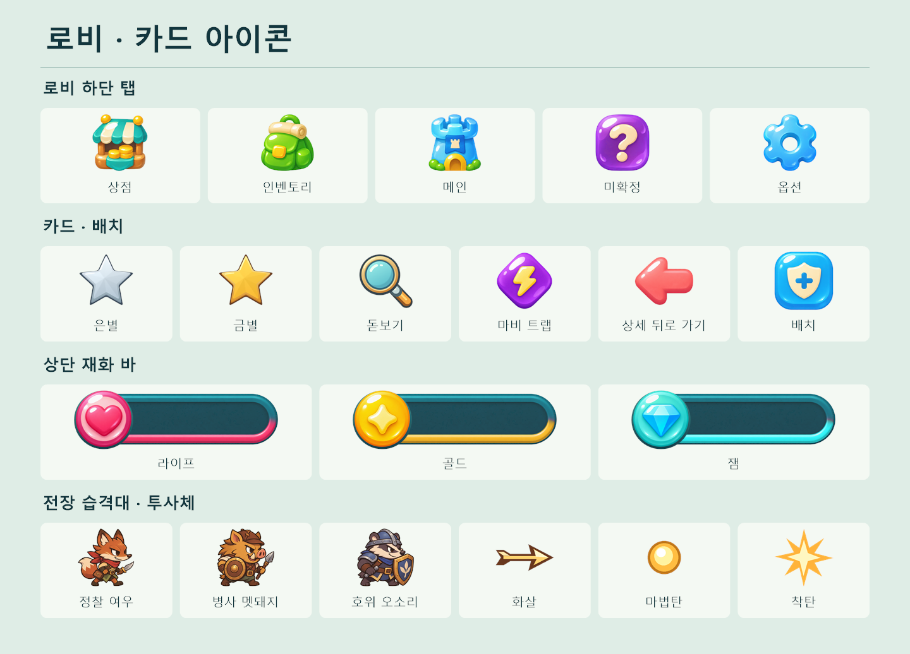
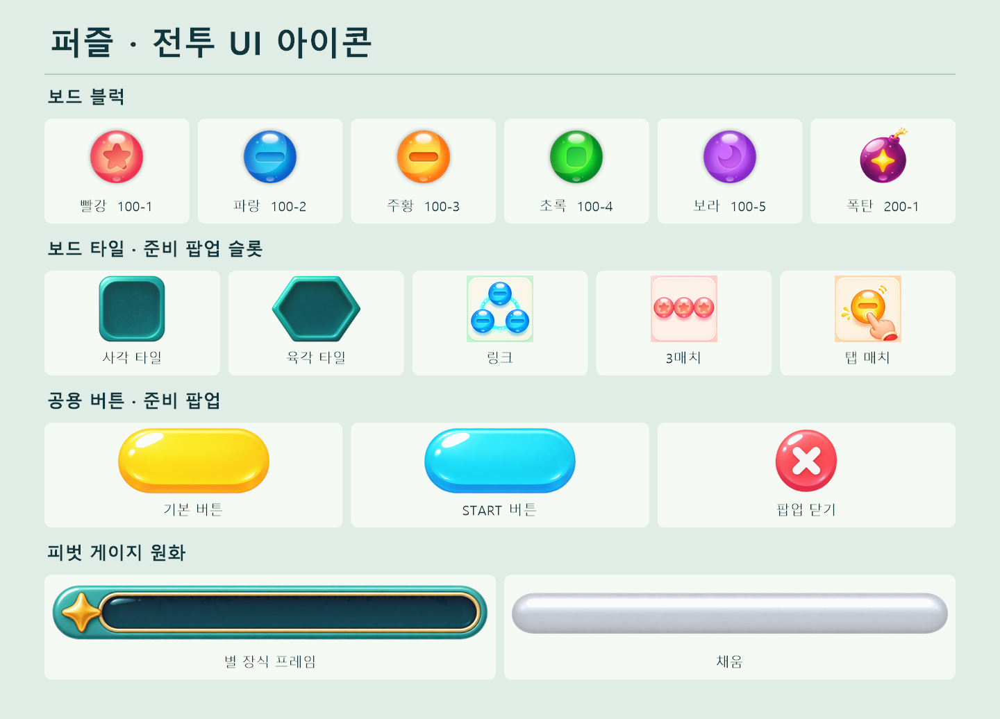
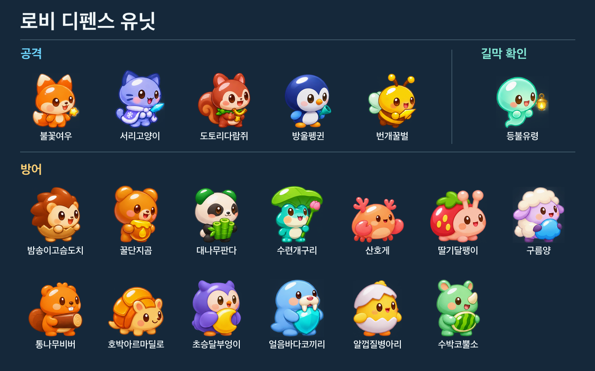

# 게임 UI와 퍼즐 아트 스타일

퍼즐 조각 원본은 [Block](../Assets/04_Resources/Ingame/Block), 보드 타일·게이지·팝업 등 다른 게임 이미지는 [Images](../Assets/04_Resources/Images)에 둔다.

## 게임 아이콘 PNG 색인

색인은 현재 게임에서 쓰는 원본 PNG를 화면별로 모은 그림이다. 아틀라스는 게임에서 자르는 칸을 기준으로 나눴고, 재화 바는 같은 행의 캡슐과 메달을 겹쳤다. 작업용 원본 20장은 압축을 풀면 프로젝트와 같은 `Assets/04_Resources/` 경로에서 찾을 수 있다. [원본 PNG 20장 ZIP](art/GameIconOriginals.zip)

ZIP과 색인은 문서 정리 당시의 스냅샷이다. 새 원화를 제작할 때는 아래 표에서 연결한 프로젝트 PNG를 사용한다.

| 로비·카드 | 퍼즐·전투 UI |
|---|---|
|  |  |

| 그룹 | 원본 PNG |
|---|---|
| 하단 탭·상단 재화 | [다섯 탭](../Assets/04_Resources/Images/LobbyNavigation.png) · [라이프·골드·잼 캡슐과 메달](../Assets/04_Resources/Images/LobbyResourceBar.png) |
| 카드·전장 | [은별·금별·돋보기·마비 트랩](../Assets/04_Resources/Images/LobbyCardIcons.png) · [상세 뒤로 가기](../Assets/04_Resources/Images/LobbyCardBack.png) · [배치](../Assets/04_Resources/Images/LobbyPlaceIcon.png) · [습격대·투사체](../Assets/04_Resources/Images/LobbyRaiders.png) |
| 보드 블럭 | [빨강](../Assets/04_Resources/Ingame/Block/Block_100-1.png) · [파랑](../Assets/04_Resources/Ingame/Block/Block_100-2.png) · [주황](../Assets/04_Resources/Ingame/Block/Block_100-3.png) · [초록](../Assets/04_Resources/Ingame/Block/Block_100-4.png) · [보라](../Assets/04_Resources/Ingame/Block/Block_100-5.png) · [폭탄](../Assets/04_Resources/Ingame/Block/Block_200-1.png) |
| 보드 타일·피벗 | [사각 타일](../Assets/04_Resources/Images/LagoonSquare.png) · [육각 타일](../Assets/04_Resources/Images/LagoonHex.png) · [별 장식 프레임](../Assets/04_Resources/Images/PivotGaugeFrame.png) · [채움](../Assets/04_Resources/Images/PivotGaugeFill.png) |
| 공용 버튼·준비 팝업 | [기본 버튼](../Assets/04_Resources/Images/Btn_MainButton_Yellow.Png) · [START](../Assets/04_Resources/Images/Btn_MainButton_Sky.Png) · [닫기](../Assets/04_Resources/Images/Icon_PictoIcon_Close01.png) · [슬롯 릴](../Assets/04_Resources/Images/ReadyReel.png) |

캐릭터의 자세와 크기를 비교할 때는 [새싹거북 방향·동작 미리보기](art/lobby-units/LobbyTurtle-preview.png), [블럭과 동물 크기 비교](art/lobby-units/Puzzle-unit-scale.png), [전체 유닛 원화](art/lobby-units/LobbyRoster.png)를 사용한다.

## 화면별 UI 기준

타이틀·로비·게임·공용 팝업 Canvas의 기준 해상도는 세로 **800 × 1422**다. Canvas Scaler는 `Scale With Screen Size`이며 너비에 맞춘다. 아래 글자 크기는 해당 씬이나 프리팹의 TMP 설정값이다. 화면별 플레이 규칙의 원문은 [게임 사양서](SPEC.md)에서 확인한다.

| 작업할 화면 | 색과 글자 위계 | 기준 리소스 |
|---|---|---|
| 타이틀·로딩 | 짙은 청록 바탕에 로비의 파란 성탑과 크림색에서 민트색으로 이어지는 72pt 영문 로고가 나타난다. 씬을 바꾸는 동안 같은 색 바탕에 로딩 문구를 띄운다. | [TitleScene](../Assets/01_Scenes/TitleScene.unity) · [LoadingScene](../Assets/01_Scenes/LoadingScene.unity) |
| 로비 | 하단 탭은 청록 바탕과 크림색 글자, 선택한 탭은 민트 받침과 짙은 글자를 쓴다. 전장 아래에는 레몬색 플레이 버튼과 방패 배치 버튼을 나란히 놓고 상점·인벤토리·옵션에서는 연한 민트 바탕으로 전환한다. | [LobbyScene](../Assets/01_Scenes/LobbyScene.unity) · [다섯 탭 아이콘](../Assets/04_Resources/Images/LobbyNavigation.png) |
| 준비 팝업 | 버터색 패널 안에서 진청록 제목(52), 안내(29), 민트 라이프 배지(26)를 읽는다. START는 하늘색, 닫기는 산호색이다. | [PopupReady](../Assets/Resources/Prefab/UI/Popup/PopupReady.prefab) · [한글 TMP 폰트](../Assets/Resources/Font/font_Ko.asset) |
| 인게임 HUD·결과 | 청록 바탕에 남은 시간은 민트, 점수는 레몬 배지로 구분한다. 결과 카드도 민트색이며 재도전은 노랑, 로비 복귀는 하늘색이다. | [GameScene](../Assets/01_Scenes/GameScene.unity) · [피벗 게이지](../Assets/02_Scripts/Battle/Pivot/PivotGaugeView.cs) |
| 로비 디펜스 | 배치 모드의 20×10 격자는 빈 셀을 잔디, 배치된 셀을 흙으로 그린다. 일반 전투는 좌우로 열린 성곽 잔디마당 위에 유닛과 흙 발판을 표시한다. 현재 경로는 청록색 `#1DA9B9`, 배치 미리보기는 금색 `#FFDC55`으로 구별한다. 적은 정찰 여우·병사 멧돼지·호위 오소리로 구분하며, 입구와 출구는 각각 연두색과 연보라색이다. | [로비 디펜스 기획](LOBBY-DEFENSE.md) |

로비 하단 탭과 플레이·배치 버튼의 개편 기준으로 [라군 젤리 A안](art/LobbyUI-LagoonJelly.png)을 선택했다. 아이콘은 퍼즐 블럭처럼 모서리를 둥글게 잡고 왼쪽 위에 밝은 반사광을 둔다. 짙은 청록 탭 바 위에서 선택한 탭은 밝은 민트색으로 강조하고, 플레이 버튼에는 레몬색을 쓴다. 상단 재화 바는 젤리 캡슐 D안으로 확정했다. 짙은 청록 바탕에 크림색 숫자를 놓고, 하트·골드·잼 테두리를 각각 메달과 같은 분홍·금색·하늘색으로 표시한다. 바로 아래 왼쪽에 닉네임 첫 글자와 이름을 담은 프로필을 배치한다. [재화 바 아틀라스](../Assets/04_Resources/Images/LobbyResourceBar.png)

숲 전경과 지면, 배치 아이콘은 ImageGen으로 제작했다. 숲은 세로형 카툰 공터와 청록색 수관을, 지면은 위에서 본 잔디·황갈색 흙을, 아이콘은 하늘색 젤리 버튼 위의 크림색 방패와 청록 더하기 표식을 기준으로 삼았다. [숲 배경](../Assets/04_Resources/Images/LobbyForest.png) · [지면 아틀라스](../Assets/04_Resources/Images/LobbyTerrain.png) · [배치 아이콘](../Assets/04_Resources/Images/LobbyPlaceIcon.png)

일반 전투 배경은 4번 시안 [버터빛 성곽 잔디마당](../Assets/04_Resources/Images/LobbyBattleMeadow.png)이다. 오른쪽 위 파란 성탑과 버터색 돌 아래로 잔디가 좌우 끝까지 이어져 몬스터 진입·퇴장 지점이 열린다. [습격대와 투사체 아틀라스](../Assets/04_Resources/Images/LobbyRaiders.png)는 위쪽에 정찰·병사·호위 세 캐릭터를, 아래쪽에 화살·마법탄·착탄 빛을 둔다. 유닛은 발밑의 행을 기준으로 겹치고 미리보기보다 크게 표시한다.

새 전장 배경 시안은 세로 **800 × 1422**에서 비교한다. [하단 탭](../Assets/04_Resources/Images/LobbyNavigation.png)과 [배치 방패](../Assets/04_Resources/Images/LobbyPlaceIcon.png)의 둥근 덩어리와 왼쪽 위 광원을 수관·돌에 반영한다. 지면은 명암 차를 줄여 [토끼 사수와 새싹거북](art/lobby-units/Puzzle-unit-scale.png)이 전장 크기에서도 읽히게 한다. 몬스터가 지나는 높이에서는 잔디가 화면 좌우 끝까지 이어지고, 나무·물·성벽 같은 장식은 통로 위아래에 놓인다.

로비 숲·지면·배치 아이콘 제작 프롬프트

- **숲 배경** — Portrait 9:16 game background illustration, lush blue-green forest clearing for a mobile casual cartoon animal tower defense. Hand-painted 2D storybook game art, rounded oak and fern silhouettes framing the sides, deep teal shaded foreground leaves, layered mint and azure distant trees, shafts of soft morning light in an airy clearing. Near the lower middle a small sunlit grassy clearing for a hero character to stand. Calm low-detail center where gameplay UI will overlay. Edge framing and foliage richness, no busy detail in center. Edge to edge, no text, no lettering, no characters, no board or grid, no icons, no border, no watermark.
- **잔디·흙** — A horizontal 2:1 atlas of exactly TWO equal square top-down ground material textures for a hand-painted casual animal game. The left half is only softly textured grassy turf in fresh medium sage / meadow green with a few very small blade clusters and variation; the right half is only rich light chestnut / warm ochre exposed garden soil with small faint grains and a few tiny speckles. Flat overhead view, subtle painterly shapes, deliberately understated, equal lighting, no shadows from large objects. Each texture fills its exact half edge to edge. Crisp straight vertical split exactly halfway. No frames, no grid, no rims, no characters, no writing or logos, no horizon, no isometric sides.
- **배치 아이콘** — 라군 젤리 원화의 배치 버튼을 정면으로 보이게 한다. 하늘색 둥근 사각형, 크림색 방패, 청록색 더하기 표식 순으로 겹치고 왼쪽 위에 흰 반사광을 둔다. 바깥은 투명하게 내보낸다.

- **일반 전투 잔디마당** — 세로 800 × 1422. 메인 탭 아이콘의 파란 성탑을 오른쪽 위에 작게 두고, 버터색 돌은 위아래 가장자리에 모은다. 중앙은 연한 풀빛 바닥이 좌우로 이어지게 하고 지면의 명암을 낮춘다. 둥근 수관과 돌에 왼쪽 위 광원을 적용한다. 캐릭터·격자·UI는 별도 레이어에서 표시한다.
- **습격대 세 종류** — A production 2D mobile RPG sprite atlas, horizontal wide layout 3:1, exactly THREE separate isolated full-body enemy creatures in a single row, centered at one-sixth, one-half, five-sixths. On transparent background. Each separated by generous transparent margin; do not overlap. All face screen RIGHT in a side three-quarter walking pose, with face and gear readable. A family of cute chibi mischievous forest raiders with large heads, two short feet and big eyes, clean deep brown outlines: left a russet red fox-like scout with red scarf, pointy nose and sly expression, middle a stocky ochre boar footsoldier with leather cap and round bronze buckler, right a big blue grey badger guard with blue steel helmet and broad shield. Friendly stylized round plush toy-like rendering, soft highlights, limited bold color masses, same scale and shared groundline. Whole figure and ears visible for all 3, no tile, no labels, no text, no scenery, no shadows extending beyond the feet. The characters must be readily distinguishable even at 40 pixels.

## 로비 디펜스 유닛

로비의 동물은 퍼즐 블록과 같은 **캐주얼 카툰**으로 그린다. 파란 블록의 하늘색을 토끼 사수의 후드에, 초록 블록의 밝은 초록을 새싹거북의 등딱지에 쓴다. 두 색 모두 금빛 장비가 닿는 가장자리에서 또렷하게 구분되어야 한다.

| 기준 | 그리는 방법 |
|---|---|
| 형태와 비율 | 토끼는 얼굴이 몸통보다 크고 귀와 콩알 모양 발이 바깥으로 보인다. 거북은 옆으로 넓은 반원형 등딱지와 머리 위 떡잎 두 장으로 알아본다. |
| 색과 빛 | 왼쪽 위에 넓은 타원 반사광 하나, 아래쪽에 진한 같은 계열 색 한 면을 둔다. 얼굴은 작은 갈색 눈, 살구색 볼과 짧은 입으로 표정을 만든다. |
| 역할 표식 | 토끼는 파란 활과 노란 화살촉, 거북은 초록 등딱지와 금빛 잎 하나를 남긴다. 작은 크기에서는 이 표식과 머리 윤곽이 먼저 읽혀야 한다. |
| 확인 크기 | 초상은 90픽셀 안팎, 전장에서는 32~40픽셀로 줄여 따뜻한 흙 바닥에서 두 유닛을 나란히 본다. 걷거나 공격해도 귀·활·떡잎이 이웃 칸에 잘리지 않아야 한다. |

**새 유닛을 그릴 때 쓰는 기준 원화**는 위 비교 그림과 아래의 실제 게임용 방향 시트·거북 초상이다. 아래 ‘초기 제작 참고용 방향 시트’는 이전 시안이다. 새로운 역할을 추가할 때는 이름, 대표색, 역할 표식만 바꾸고 얼굴 비율과 광원은 이 기준을 따른다.

제작 문장 예시 — “파란 퍼즐 블록과 초록 퍼즐 블록 옆에 놓일 작은 동물 유닛. 머리가 큰 둥근 몸, 콩알 같은 발, 살구색 볼. 왼쪽 위에 타원형 흰 반사광 하나, 아래쪽에 한 단계 진한 색. 손에 든 장비는 한눈에 읽히는 덩어리 하나. 한 칸에 들어가는 전신, 투명 배경.” 털 한 올, 가죽 주름, 금속 흠집처럼 실제 재질을 묘사하는 세부는 생략한다.

배치 모드에서는 화면 하단의 가로 카드 목록에서 선택한 카드 가장자리에 금색 테두리와 빛 번짐을 표시한다. 전장 위 스테이지명 옆에는 진행 버튼을, 전장 아래에는 노란 플레이 버튼과 하늘색 방패를 둔다. [로비 배치와 조작](LOBBY-DEFENSE.md)

- [토끼 사수 방향 시트](../Assets/04_Resources/Images/LobbyArcher8Way.png)는 S · SE · E · NE · N · NW · W · SW 순서로 대기·걷기·사격·특수 포즈를 담는다. 전장에서는 입구를 바라보고, 사격할 때 표적 방향으로 활을 내민다.
- [새싹거북 프리팹](../Assets/Resources/Prefab/LobbyTurtle.prefab)은 [파츠 아틀라스](../Assets/Resources/Texture/LobbyTurtle/LobbyTurtleAtlas.png)의 몸통 5방향·발·움츠린 등딱지를 조합한다. 피격 시 적 쪽으로 몸을 숨겨도 떡잎과 금빛 잎 표식은 보인다. [남동쪽 초상](art/lobby-units/SproutTurtle-portrait.png)

### 인벤토리 보유 카드

[공용 카드 프레임](../Assets/04_Resources/Images/LobbyInventoryCard.png)은 세로 3:4 비율이다. 민트색 젤리 테두리 안쪽 숲 배경에 캐릭터를 올리고, 청록색 명판에 이름과 합산 공격·방어·체력, 레몬색 보너스 합계를 표시한다. 왼쪽 위에는 별 아이콘과 숫자 등급을 나란히 둔다. 확대하면 카드 아래의 크림색 표에서 능력치별 기본값·뽑기 보너스·합계를 비교할 수 있다. 등급 배너에는 현재 별의 점수 구간과 사수의 사거리를 표시한다. 표시 항목과 등급 산정은 [카드 사양서](LOBBY-CARDS.md)를 따른다.

인벤토리는 보유 카드를 획득 순서대로 한 줄에 세 장씩 표시한다. 스크롤하면 보이는 캐릭터가 대기 동작을 반복한다. 768 × 192 [카드 아이콘 원화](../Assets/04_Resources/Images/LobbyCardIcons.png)는 왼쪽부터 은별, 금별, 돋보기, 번개가 박힌 보라색 마비 트랩이다. 등급별 별은 카드 왼쪽 위, 돋보기는 오른쪽 위, 마비 트랩은 해당 카드의 초상 자리에 놓는다.

카드 전체를 누르면 그 자리에서 중앙으로 커지고 뒤의 목록이 어두워진다. 확대가 끝나면 특수 동작을 한 번 재생하고 대기로 돌아온다. 오른쪽 위의 [빨간 뒤로 가기 화살표](../Assets/04_Resources/Images/LobbyCardBack.png)를 누르면 원래 자리로 축소된다. 화면 전환 애니메이션을 끄면 팝업이 즉시 열리고 닫힌다. **다시 재생**으로 동작을 반복할 수 있다. 토끼 사수는 원래 방향 시트의 특수 포즈를, 새싹거북과 신규 동물은 프리팹 동작을, 마비 트랩은 보라색 보석의 반짝임을 사용한다.

[카드 앞면 PNG 21장](art/lobby-units/InventoryCardFronts.zip)에는 이름과 원화가 들어 있다. 별 등급과 능력치를 표시할 때는 [카드 사양서의 화면별 표시 항목](LOBBY-CARDS.md#화면에-표시할-정보)을 따른다.

### 신규 캐릭터 프리팹과 방향 시트

[신규 프리팹](../Assets/Resources/Prefab/LobbyRoster)은 같은 이름의 [RGBA 방향 시트](../Assets/Resources/Texture/LobbyRoster)와 [공유 Animator](../Assets/Resources/Animation/LobbyRoster/Roster.controller)를 사용한다. 한 장은 2048 × 1024, 한 칸은 256 × 256이다. 열은 S · SE · E · NE · N · NW · W · SW, 행은 위에서 대기 · 걷기 · 공격 · 특수 동작이다. 서쪽 세 방향은 동쪽 원화의 좌우 반전이다.

Unity에서 프리팹을 Canvas 아래에 두고 Animator에서 `Walk_SE`나 `Special_W`를 재생한다. 대기와 걷기는 제자리에서 반복하고, 공격과 특수 동작은 같은 방향 대기로 돌아온다. 관절형 새싹거북과 달리 신규 19종은 시트의 자세, 발쪽 피벗, 이동·회전·크기 키를 조합한다. 신규 공격 유닛은 일반 사격에 표적 방향의 `Attack`, 적을 처치한 탄에 같은 방향의 `Special`을 재생한다. 방어 유닛은 피격 때 `Special`로 몸을 움츠리거나 방패를 내세운다. [전체 이름과 로비 전투 역할](LOBBY-DEFENSE.md#배치-캐릭터와-등불유령)

### 초기 제작 참고용 방향 시트

[방패병 시트](art/lobby-units/Wall-8way.png) · [사수 시트](art/lobby-units/Archer-8way.png). 투명 PNG 한 장은 2048 × 1024이며 한 칸은 256 × 256이다. 열은 왼쪽부터 S · SE · E · NE · N · NW · W · SW, 행은 위부터 Idle · Walk · Attack · Special 순이다. S는 화면 아래를 바라보는 정면이다. 등 뒤 투구와 화살통은 정면 원화를 바탕으로 보완했고, 서쪽 세 방향은 동쪽 포즈를 반전해 장비 손도 함께 바뀐다.

| 동작 | 방패병 | 사수 |
|---|---|---|
| Idle | 발을 고정하고 방패를 앞에 세운다. | 활을 내리고 표적을 살핀다. |
| Walk | 방패를 든 채 짧게 발을 내딛는다. | 활을 몸 옆에 두고 길게 내딛는다. |
| Attack | 방패를 앞으로 밀어 짧은 충격을 표시한다. | 활시위를 놓아 화살을 쏜다. |
| Special | 방패에 금빛 보호막이 번진다. | 활 끝에 푸른 빛의 화살이 맺힌다. |

[Unity 샘플 패키지](art/lobby-units/LobbyUnits.unitypackage)를 임포트하면 `Assets/LobbyUnits` 아래에 두 SpriteRenderer 프리팹과 Animator Controller가 생긴다. 상태 이름은 `E_Walk`처럼 방향과 동작을 조합한다. Idle·Walk는 제자리 반복, Attack·Special은 같은 방향의 Idle로 복귀한다. 공격과 스페셜은 캐릭터 동작 샘플이다. 실제 피해·보호막·투사체 방향 판정은 게임 규칙에서 정의한다.

## 버튼·닫기 아이콘·슬라이더

| 요소 | 새 UI에 적용할 때 |
|---|---|
| 공용 버튼 | 레몬색 상판의 왼쪽 위에 흰 반사광을 두고, 아래를 진한 노랑으로 마무리한다. 기본 프리팹의 라벨은 30pt 고동색(#5B3816)이며 실제 화면에서 크기를 조정한다. [Button 프리팹](../Assets/Resources/Prefab/UI/Module/Button.prefab) · [노란 버튼](../Assets/04_Resources/Images/Btn_MainButton_Yellow.Png) |
| 준비 팝업 조작 | START에는 하늘색 젤리 버튼을 쓰고, 닫기는 산호색 원 안에 흰색 ×를 표시한다. [하늘색 버튼](../Assets/04_Resources/Images/Btn_MainButton_Sky.Png) · [닫기 아이콘](../Assets/04_Resources/Images/Icon_PictoIcon_Close01.png) |
| 슬라이더 원화 | 짙은 남색 홈, 밝은 파란 채움, 청록색 방패 아이콘이 한 세트다. 프레임과 채움은 양 끝의 테두리를 보존하며 가로로 늘리고, 아이콘은 비율을 유지한다. 대전 HUD의 피벗 게이지는 아래 별 장식 원화를 쓴다. [프레임](../Assets/04_Resources/Images/Slider05_Frame.png) · [채움](../Assets/04_Resources/Images/Slider05_Fill.png) · [아이콘](../Assets/04_Resources/Images/Slider05_Icon.png) |

버튼 원화를 교체할 때는 Sprite Editor의 Border를 원본과 대조한다. 왼쪽·아래·오른쪽·위 순서로 노란 버튼은 `20 / 40 / 20 / 20`, 하늘색 버튼은 `27 / 0 / 27 / 0`이다. 임포트 값은 파일마다 다르므로 같은 역할의 원본을 기준으로 삼는다.

## 보드 블럭

일반 블럭 다섯 종은 둥근 몸체와 위쪽 반사광을 공유한다. 중앙 문양은 빨강이 별, 파랑과 주황이 가로 홈, 초록이 둥근 사각형, 보라가 초승달이다. 모드 선택 UI에서 보드 조각을 인용할 때도 색과 문양을 한 쌍으로 유지한다.

| 생성할 때 첨부한 기준 그림 | 같은 스타일로 만든 원형 폭탄 |
|---|---|
|  |  |

새 블럭을 만들 때는 왼쪽 PNG를 참조 이미지로 첨부한다. 한 칸에 놓인 젤리처럼 보이게 하는 요소는 둥근 실루엣, 위쪽의 넓고 밝은 반사광, 아래쪽으로 짙어지는 색이다. 폭탄에서는 이 세 요소를 유지하고, 작은 화면에서도 일반 블럭과 구별되도록 짧은 심지로 외곽선을 바꾸고 중앙에 금색 불꽃 하나를 넣었다.

**폭탄 생성 프롬프트 예시**

> 첨부한 빨간 젤리 블럭과 한 세트로 쓸 원형 폭탄 아이콘을 그려줘. 정사각형 투명 캔버스 가운데 자두색 젤리 구체를 놓고, 왼쪽 위에는 연분홍색 타원형 반사광을 크게 넣어줘. 중앙에는 금색 네 갈래 불꽃 하나, 오른쪽 위에는 짧게 휜 심지와 작은 불빛을 넣어줘. 심지 끝까지 투명 여백 안에 들어오게 하고 바닥 그림자와 글자는 생략해줘. 32픽셀로 줄여도 심지와 중앙 문양이 읽히게 해줘.

최종 PNG는 기존 블럭과 같은 **256 × 256**, 투명 배경, 중앙 피벗으로 맞춘다. Unity에서는 단일 Sprite, Pixels Per Unit `1`로 임포트한다. 보드에 나란히 놓았을 때 일반 블럭과 몸체 크기가 어울리고 심지가 잘리지 않는지 확인한다. 파일명과 Addressables 주소는 블럭 ID를 따르며, 폭탄의 주소는 `Block_200-1`이다. [새 블럭 추가 방법](RULES-AND-STAGES.md#새-블럭-추가-방법)

## 준비 팝업 슬롯

릴은 **가로 3:1 이미지 한 장**이다. [파란 블럭](../Assets/04_Resources/Ingame/Block/Block_100-2.png), [빨간 별 블럭](../Assets/04_Resources/Ingame/Block/Block_100-1.png), [주황 블럭](../Assets/04_Resources/Ingame/Block/Block_100-3.png)의 둥근 실루엣과 타원형 반사광을 사용한다. 민트·분홍·살구색 카드에 연결, 가로 정렬, 탭 동작을 각각 담는다.

**릴 생성 프롬프트 예시**

> 첨부한 보드 젤리의 색, 가운데 문양, 반사광을 유지해 같은 너비의 정사각형 카드 세 장을 가로로 붙여줘. 왼쪽은 파란 젤리 세 개를 빛나는 선으로 연결하고, 가운데는 빨간 별 젤리 세 개를 한 줄에 놓고, 오른쪽은 손끝이 주황 젤리를 누르는 순간을 그려줘. 밝은 파스텔 바탕에 각 그림이 온전히 들어가도록 하고 글자는 생략해줘.

기존 릴을 교체할 때는 정지 화면에서 한 칸씩 잘라 본다. 각 칸에 상징 하나가 온전히 보이고, 왼쪽부터 **링크 → 3매치 → 탭 매치** 순서가 컨트롤러의 `RulePaths`와 `ModeNames`에 맞아야 한다. 릴은 `PopupReady` 프리팹의 `RawImage`가 참조하는 텍스처다. 가로 반복(Wrap U = Repeat)을 유지해야 마지막 칸에서 첫 칸으로 이어진다. [준비 팝업 동작](UI.md#준비-팝업의-플레이-진입) · [PopupReady.cs](../Assets/02_Scripts/UI/Popup/PopupReady.cs)

## 보드 타일과 피벗 게이지

- [사각 타일](../Assets/04_Resources/Images/LagoonSquare.png)과 [육각 타일](../Assets/04_Resources/Images/LagoonHex.png)은 청록색 에나멜에 오목하게 들어간 칸을 정면에서 본 모습이다. 생성 시 가운데를 비우고 왼쪽 위 가장자리만 밝게 잡아 젤리 블럭이 먼저 읽히게 했다.
- [게이지 프레임](../Assets/04_Resources/Images/PivotGaugeFrame.png)은 금색 별이 달린 청록색 캡슐, [채움](../Assets/04_Resources/Images/PivotGaugeFill.png)은 색을 입힐 수 있는 진주색 젤리 막대다. 두 원화 모두 글자와 눈금 없이 투명 배경으로 생성했다. 충전 중에는 청록빛, 활성 중에는 주황빛으로 채운다.

## 준비 팝업 패널

[레몬색 패널 원본](../Assets/04_Resources/Images/ReadyPanelYellow.png)은 중앙이 연한 버터색이고 가장자리가 둥근 젤리 테두리다. 왼쪽 위 반사광을 테두리에 두고 중앙을 비워 제목·릴·라이프가 올라갈 자리를 확보한다. 모서리 바깥은 투명하게 내보낸다. 팝업 프리팹은 단일 Sprite를 흰색 틴트로 표시하고, 진청록 본문과 민트색 라이프 배지, 하늘색 START 버튼을 올린다.
