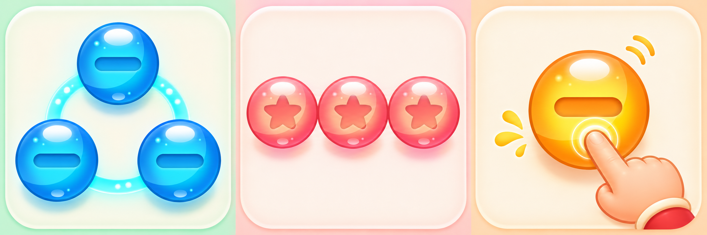

# 게임 UI와 퍼즐 아트 스타일

퍼즐 조각 원본은 [Block](../Assets/04_Resources/Ingame/Block), 보드 타일·게이지·팝업 등 다른 게임 이미지는 [Images](../Assets/04_Resources/Images)에 둔다.

## 화면별 UI 기준

타이틀·로비·게임·공용 팝업 Canvas의 기준 해상도는 세로 **800 × 1422**다. Canvas Scaler는 `Scale With Screen Size`이며 너비에 맞춘다. 아래 글자 크기는 해당 씬이나 프리팹의 TMP 설정값이다.

| 작업할 화면 | 색과 글자 위계 | 기준 리소스 |
|---|---|---|
| 타이틀 | 영문 CI ‘NEVER LAND’는 밝은 민트색 `#00FF80`, 크기 52의 `font_En`을 쓴다. | [TitleScene](../Assets/01_Scenes/TitleScene.unity) |
| 로비 | 모드 진입 버튼은 노란 공용 버튼을 사용한다. 상태 안내는 흰색 한글 TMP, 크기 30이다. | [LobbyScene](../Assets/01_Scenes/LobbyScene.unity) |
| 준비 팝업 | 버터색 패널 위에 고동색 `#493128` 글자를 올린다. 제목 60, 모드 안내 30, 라이프 27 순으로 읽히며 START는 하늘색으로 구분한다. | [PopupReady](../Assets/Resources/Prefab/UI/Popup/PopupReady.prefab) · [한글 TMP 폰트](../Assets/Resources/Font/font_Ko.asset) |
| 인게임 HUD·결과 | 점수와 타이머는 흰색 36, 리플레이 상태는 흰색 27이다. 대전 피벗은 타이머 아래에 같은 폰트로 크기 24의 라벨을 붙인다. | [GameScene](../Assets/01_Scenes/GameScene.unity) · [PivotGaugeView](../Assets/02_Scripts/Battle/Pivot/PivotGaugeView.cs) |
| 로비 디펜스 | 목표 화면은 평면 격자다. 짙은 청회색 바닥 위에서 현재 경로는 청록색 `#4DA1A6`, 배치 미리보기는 금색 `#F8C564`으로 구별한다. 적은 산호색, 입구와 출구는 각각 연두색과 연보라색이다. | [로비 디펜스 기획](LOBBY-DEFENSE.md) |

## 로비 디펜스 유닛

현재 고용 버튼과 20열 전장에는 [동물 유닛 원화](../Assets/04_Resources/Images/LobbyAnimalUnits.png)를 사용한다. 방패병은 초록 블록의 밝은 윗면과 짙은 아랫면을 등껍질에 쓰고, 주황 블록의 금색을 방패에 썼다. 토끼 사수는 파랑 블록의 청록색에서 코발트색으로 내려가는 명암을 후드와 활에 쓴다. 두 캐릭터 모두 장비에 둥근 흰 반사광을 두고 얼굴은 부드러운 크림색으로 남긴다. 100열 지도에서는 유닛을 역할색 표식으로 축약한다.

기획 전장의 역할색을 적용한 **1×1칸 캐릭터 원화 제작 기준**이다. 두 유닛 모두 짧은 몸통과 둥근 모서리, 짙은 청회색 외곽선, 왼쪽 위의 짧은 반사광을 쓴다. 원본은 투명 정사각형에 그리고 장비까지 한 칸 안에 넣는다. 밝은 장식은 역할을 알려주는 장비 한 곳에 모은다. [버튼 외곽선 참고](../Assets/04_Resources/Images/Btn_MainButton_Sky.Png)

| 제작 요소 | 디펜스 유닛 · 방패병 (`Wall`, 길막) | 공격 유닛 · 사수 (`Archer`) |
|---|---|---|
| 배치할 이유 | 한 칸을 막아 적이 사거리 안으로 돌아가게 한다. 봉쇄 시 공격을 견딘다. | 길 옆에서 사거리 안의 적을 반복 공격해 처치 골드를 만든다. |
| 실루엣과 표식 | 낮고 넓은 체형. 몸 앞을 덮는 둥근 사각 방패와 수평 상단 테두리가 작은 크기에서도 남는다. | 좁고 높게 선 체형. 몸 옆으로 벌어진 활과 비스듬한 화살촉이 한눈에 보이게 한다. |
| 재질과 색 | 황토색 `#BFA16E` 방패에 무광 몸체와 밝은 모서리 한 줄. 금색 예상 경로 위에서도 방패의 짙은 테두리를 유지한다. | 하늘색 `#68C9FF` 옷에 밝은 에나멜 활, 짙은 활 안쪽 여백. 청록색 경로 위에서도 활의 곡선이 읽히게 한다. |
| 전투 피드백 | 피격 시 방패가 짧게 밀렸다 돌아온다. 내구도가 낮아지면 방패에 큰 균열 하나를 표시하고 파괴 시 점유 칸을 비운다. | 공격 시 활을 당겼다 놓고 표적에 작은 명중광을 준다. 연속 사격 중에도 적의 위치와 체력 표시가 읽혀야 한다. |

**화면별 판독 기준.** 고용 버튼에는 전신과 ‘길막 유닛’·‘공격 유닛’ 이름을 함께 쓴다. 20열 배치 보기에서는 같은 방패와 활 실루엣을 유지한다. 방패병 후보는 바뀔 길을, 사수 후보는 바뀔 길과 사거리 안의 경로 구간을 강조한다. 100열 전체 보기에서는 외곽선과 역할색만 남기고 경로의 연속성을 우선한다. 바닥 트랩은 낮은 보라색 바닥 표식으로 두어 통과 가능한 칸임을 드러낸다.

**원화 승인 기준.** 세로 화면 폭 360에서 20열로 축소한 두 유닛을 흑백으로 나란히 보고 방패와 활을 구별할 수 있는지 확인한다. 실제 경로색 위에 얹어 인접한 칸을 가리거나 노란 미리보기 선처럼 보이는지도 확인한다. [로비 디펜스 기획](LOBBY-DEFENSE.md#방치-수익-측정과-배치-비교안)

### 방향별 동작 시트

[방패병 시트](art/lobby-units/Wall-8way.png) · [사수 시트](art/lobby-units/Archer-8way.png). 투명 PNG 한 장은 2048 × 1024이며 한 칸은 256 × 256이다. 열은 왼쪽부터 S · SE · E · NE · N · NW · W · SW, 행은 위부터 Idle · Walk · Attack · Special 순이다. S는 화면 아래를 바라보는 정면이다. 등 뒤 투구와 화살통은 정면 원화를 바탕으로 보완했고, 서쪽 세 방향은 동쪽 포즈를 반전해 장비 손도 함께 바뀐다.

| 동작 | 방패병 | 사수 |
|---|---|---|
| Idle | 발을 고정하고 방패를 앞에 세운다. | 활을 내리고 표적을 살핀다. |
| Walk | 방패를 든 채 짧게 발을 내딛는다. | 활을 몸 옆에 두고 길게 내딛는다. |
| Attack | 방패를 앞으로 밀어 짧은 충격을 표시한다. | 활시위를 놓아 화살을 쏜다. |
| Special | 방패에 금빛 보호막이 번진다. | 활 끝에 푸른 빛의 화살이 맺힌다. |

[Unity 샘플 패키지](art/lobby-units/LobbyUnits.unitypackage)를 임포트하면 `Assets/LobbyUnits` 아래에 두 SpriteRenderer 프리팹과 Animator Controller가 생긴다. 상태 이름은 `E_Walk`처럼 방향과 동작을 조합한다. Idle·Walk는 제자리 반복, Attack·Special은 같은 방향의 Idle로 복귀한다. 공격과 스페셜은 캐릭터 동작 샘플이다. 실제 피해·보호막·투사체 방향 판정은 게임 규칙에서 정의한다.

## 버튼·닫기 아이콘·슬라이더

| 요소 | 새 UI에 적용할 때 |
|---|---|
| 공용 버튼 | 노란 상판, 주황색 아래 면, 검은 외곽선이 눌리는 면의 높이를 보여준다. 라벨은 별도 TMP로 중앙에 놓는다. 기본 프리팹은 300 × 145, 글자 크기 50, 글자색 `#323232`다. 폭을 바꿀 때는 Sliced 설정을 유지한다. [Button 프리팹](../Assets/Resources/Prefab/UI/Module/Button.prefab) · [노란 버튼](../Assets/04_Resources/Images/Btn_MainButton_Yellow.Png) |
| 준비 팝업 조작 | START는 같은 실루엣의 파란 버튼을 쓴다. 닫기 아이콘은 검은 테두리와 아래쪽 그림자가 있는 흰색 ×다. 교체할 때는 × 주변의 투명 여백까지 비교한다. [하늘색 버튼](../Assets/04_Resources/Images/Btn_MainButton_Sky.Png) · [닫기 아이콘](../Assets/04_Resources/Images/Icon_PictoIcon_Close01.png) |
| 슬라이더 원화 | 짙은 남색 홈, 밝은 파란 채움, 청록색 방패 아이콘이 한 세트다. 프레임과 채움은 양 끝의 테두리를 보존하며 가로로 늘리고, 아이콘은 비율을 유지한다. 대전 HUD의 피벗 게이지는 아래 별 장식 원화를 쓴다. [프레임](../Assets/04_Resources/Images/Slider05_Frame.png) · [채움](../Assets/04_Resources/Images/Slider05_Fill.png) · [아이콘](../Assets/04_Resources/Images/Slider05_Icon.png) |

버튼 원화를 교체할 때는 Sprite Editor의 Border를 원본과 대조한다. 왼쪽·아래·오른쪽·위 순서로 노란 버튼은 `20 / 40 / 20 / 20`, 하늘색 버튼은 `27 / 0 / 27 / 0`이다. 임포트 값은 파일마다 다르므로 같은 역할의 원본을 기준으로 삼는다.

## 보드 블럭

일반 블럭 다섯 종은 둥근 몸체와 위쪽 반사광을 공유한다. 중앙 문양은 빨강이 별, 파랑과 주황이 가로 홈, 초록이 둥근 사각형, 보라가 초승달이다. 모드 선택 UI에서 보드 조각을 인용할 때도 색과 문양을 한 쌍으로 유지한다.

| 생성할 때 첨부한 기준 그림 | 같은 스타일로 만든 원형 폭탄 |
|---|---|
|  |  |

새 블럭을 만들 때는 왼쪽 PNG를 참조 이미지로 첨부한다. 한 칸에 놓인 젤리처럼 보이게 하는 요소는 둥근 실루엣, 위쪽의 넓고 밝은 반사광, 아래쪽으로 짙어지는 색이다. 폭탄에서는 이 세 요소를 유지하고, 작은 화면에서도 일반 블럭과 구별되도록 짧은 심지로 외곽선을 바꾸고 중앙에 금색 불꽃 하나를 넣었다.

**폭탄 생성 프롬프트 예시**

> 첨부한 빨간 젤리 블럭과 한 세트로 쓸 원형 폭탄 아이콘을 그려줘. 정사각형 투명 캔버스 가운데 자두색 젤리 구체를 놓고, 왼쪽 위에는 연분홍색 타원형 반사광을 크게 넣어줘. 중앙에는 금색 네 갈래 불꽃 하나, 오른쪽 위에는 짧게 휜 심지와 작은 불빛을 넣어줘. 심지 끝까지 투명 여백 안에 들어오게 하고 바닥 그림자와 글자는 생략해줘. 32픽셀로 줄여도 심지와 중앙 문양이 읽히게 해줘.

최종 PNG는 기존 블럭과 같은 **256 × 256**, 투명 배경, 중앙 피벗으로 맞춘다. Unity에서는 단일 Sprite, Pixels Per Unit `1`로 임포트한다. 보드에 나란히 놓았을 때 일반 블럭과 몸체 크기가 어울리고 심지가 잘리지 않는지 확인한다. 파일명과 Addressables 주소는 블럭 ID를 따르며, 폭탄의 주소는 `Block_200-1`이다. [새 블럭 추가 방법](RULES-AND-STAGES.md#새-블럭-추가-방법)

## 준비 팝업 슬롯

릴은 **가로 3:1 이미지 한 장**이다. [파란 블럭](../Assets/04_Resources/Ingame/Block/Block_100-2.png), [빨간 별 블럭](../Assets/04_Resources/Ingame/Block/Block_100-1.png), [주황 블럭](../Assets/04_Resources/Ingame/Block/Block_100-3.png)의 둥근 실루엣과 타원형 반사광을 사용한다. 민트·분홍·살구색 카드에 연결, 가로 정렬, 탭 동작을 각각 담는다.

**릴 생성 프롬프트 예시**

> 첨부한 보드 젤리의 색, 가운데 문양, 반사광을 유지해 같은 너비의 정사각형 카드 세 장을 가로로 붙여줘. 왼쪽은 파란 젤리 세 개를 빛나는 선으로 연결하고, 가운데는 빨간 별 젤리 세 개를 한 줄에 놓고, 오른쪽은 손끝이 주황 젤리를 누르는 순간을 그려줘. 밝은 파스텔 바탕에 각 그림이 온전히 들어가도록 하고 글자는 생략해줘.

기존 릴을 교체할 때는 정지 화면에서 한 칸씩 잘라 본다. 각 칸에 상징 하나가 온전히 보이고, 왼쪽부터 **링크 → 3매치 → 탭 매치** 순서가 컨트롤러의 `RulePaths`와 `ModeNames`에 맞아야 한다. 릴은 `PopupReady` 프리팹의 `RawImage`가 참조하는 텍스처다. 가로 반복(Wrap U = Repeat)을 유지해야 마지막 칸에서 첫 칸으로 이어진다. [준비 팝업 동작](UI.md#준비-팝업의-플레이-진입) · [PopupReady.cs](../Assets/02_Scripts/UI/Popup/PopupReady.cs)

## 보드 타일과 피벗 게이지

- [사각 타일](../Assets/04_Resources/Images/LagoonSquare.png)과 [육각 타일](../Assets/04_Resources/Images/LagoonHex.png)은 청록색 에나멜에 오목하게 들어간 칸을 정면에서 본 모습이다. 생성 시 가운데를 비우고 왼쪽 위 가장자리만 밝게 잡아 젤리 블럭이 먼저 읽히게 했다.
- [게이지 프레임](../Assets/04_Resources/Images/PivotGaugeFrame.png)은 금색 별이 달린 청록색 캡슐, [채움](../Assets/04_Resources/Images/PivotGaugeFill.png)은 색을 입힐 수 있는 진주색 젤리 막대다. 두 원화 모두 글자와 눈금 없이 투명 배경으로 생성했다. 충전 중에는 청록빛, 활성 중에는 주황빛으로 채운다.

## 준비 팝업 패널

[레몬색 패널 원본](../Assets/04_Resources/Images/ReadyPanelYellow.png)은 중앙이 연한 버터색이고 가장자리가 둥근 젤리 테두리다. 왼쪽 위 반사광을 테두리에 두고 중앙을 비워 제목·릴·라이프가 올라갈 자리를 확보한다. 모서리 바깥은 투명하게 내보낸다. 팝업 프리팹은 단일 Sprite를 흰색 틴트로 표시하고, 본문에는 진한 갈색, START에는 하늘색 버튼을 사용한다.
